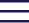

# Corporate Identity

Ontwerp en maak voor een opdrachtgever een website op basis van een bestaande huisstijl.

De instructie vind je in: [INSTRUCTIONS](https://github.com/fdnd-task/look-and-feel-corporate-identity/blob/main/docs/INSTRUCTIONS.md)


# Titel
<!-- Geef je project een titel en schrijf in één zin wat het is -->

## Beschrijving
<!-- In de Beschrijving staat hoe je project er uit ziet, hoe het werkt en wat je er mee kan. -->
<!-- Voeg een mooie poster visual toe 📸 -->
<!-- Voeg een link toe naar Github Pages 🌐-->
The website now is a lot more responsive than the previous sprint and also certain features that were not working are functioning, like the filter and the hamburger menu for example.
The website compared to how it looks in the previous Sprint has some upgrades:
### Desktop
In the header there is a hover effect on the materiaal indienen button:
not hovered:


hovered:


there is also a hover effect on the content self:

not hovered:


hovered:


The borders of the images are all the darkblue for both desktop and mobile:


The filters are sticky for a certain amount of time before sliding out of the screen and when you scroll up a bit they will come back in the screen which can be seen on the website.

### Mobile
the filter button also stops right above the footer:


for the hamburger menu I came up with a quick fix in order to get it working:


for the filters/ categories i added the color of the category as the border of the button ans with the icons next to it:


## Kenmerken
<!-- Bij Kenmerken staat welke technieken zijn gebruikt en hoe. Wat is de HTML structuur? Wat zijn de belangrijkste dingen in CSS? Wat is er met Javascript gedaan en hoe? Misschien heb je een framwork of library gebruikt? -->

I worked with HTML CSS and JS
In the HTML i worked more symantically than the previous sprint. I made less use of divs and worked more with `article`, `section`, `header`, `main`, `footer`, `button`, `ul`, `li`, `nav`.

A tip that I used was for the popover of the headermenu and the filter for mobile which i found out from a teacher that it could be done with just html:
```HTML
<button class="hamburger-menu" popovertarget="hamburger-list"></button>
        <nav class="menu" popover id="hamburger-list">
            <button popovertarget="hamburger-list" class="close-hamburger"></button>
            <ul>
                <li><a href="#">Oefenen</a></li>
                <li><a href="#">verdiepen</a></li>
                <li><a href="#">Inspiratie</a></li>
                <li><a href="#">over</a></li>
                <li><a href="#" class="mobile-material">Material Indienen</a></li>
            </ul>
        </nav>
```

With CSS i made a lot of use of nesting just to have everything a bit more organised and also to to know which styling belongs in which landmark:
```CSS
header {
    display: flex;
    align-items: center;
    gap: 15px;
    padding: 20px;
    border-bottom: 1px solid var(--color-neutral-normal);

    .material-dskt {
        display: none;
    }

    /* Materiaal indienen button styling */
    .mobile-material,
    .material-dskt {
        padding: 14px 20px;
        border: none;
        background-color: var(--color-interactive-light);
        color: var(--dark-accent);
        font-family: "Quantico", sans-serif;
        cursor: pointer;
    }

    .mobile-material {
        display: inline-block;
    }

    /* Hamburger menu styling */
    .hamburger-menu {
        order: 1;
        border: none;
    }

    .close-hamburger {
        border: none;
    }

    .close-hamburger,
    .hamburger-menu {
        cursor: pointer;
    }

    .close-hamburger {
        position: absolute;
        top: 20px;
        right: 20px;
    }

    .icons {
        display: flex;
        gap: 20px;
        margin-left: auto;
        list-style-type: none;
    }

    .menu ul {
        display: flex;
        flex-direction: column;
        gap: 30px;
        align-items: center;
        list-style-type: none;
    }

    .menu a {
        text-decoration: none;
    }

    .menu {
        margin: 0;
        width: 100%;
    }


}
```

I did make a bit of use of JS in order to get that desktop fliter to slid in and out and also to disable the the mobile filter button from working
```JS
const desktopLayout = window.matchMedia("(min-width: 1150px)");
const filterButton = document.querySelector(".mobile-filter");
const filterPopover = document.querySelector("#categories");
const filterSection = document.querySelector(".filter-section");
const filterScrollDistance = 750;
let previousScroll = window.scrollY;
let lastUpwardScroll = 0;

function updateStickyFilters() {
    const currentScroll = window.scrollY;
    if (currentScroll < previousScroll) {
        lastUpwardScroll = currentScroll;
    }

    const scrolledFarEnough = currentScroll - lastUpwardScroll >= filterScrollDistance;
    filterSection.classList.toggle("is-hidden", desktopLayout.matches && scrolledFarEnough);
    previousScroll = currentScroll;
}

function updateFilterButton() {
    filterButton.disabled = desktopLayout.matches;

    if (desktopLayout.matches && filterPopover.matches(":popover-open")) {
        filterPopover.hidePopover();
    }

    updateStickyFilters();
}

desktopLayout.addEventListener("change", updateFilterButton);
window.addEventListener("scroll", updateStickyFilters, { passive: true });
updateFilterButton();

```

## Bronnen

## Licentie

This project is licensed under the terms of the [MIT license](./LICENSE).
